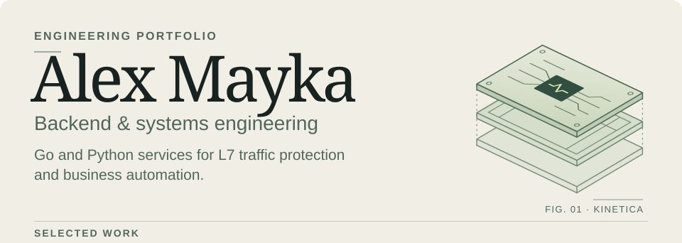
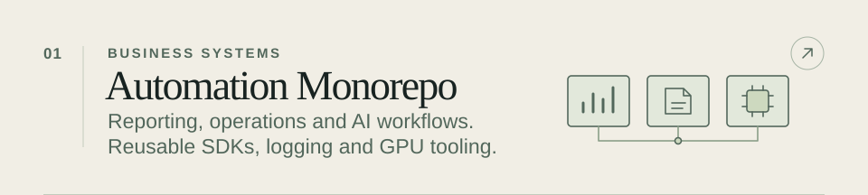
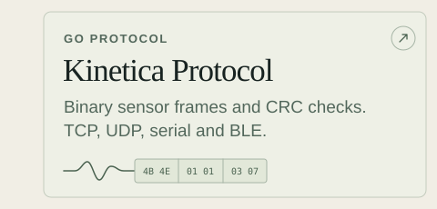
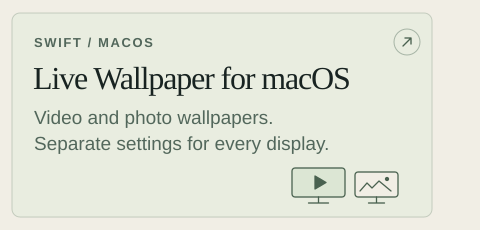
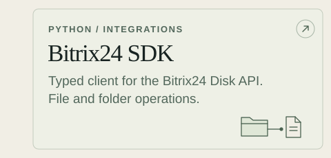
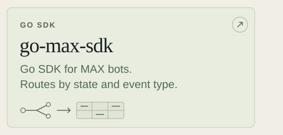
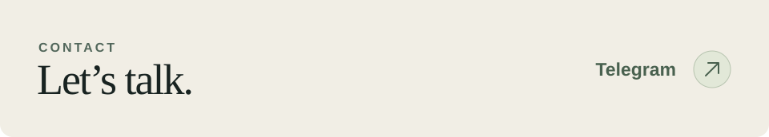

<picture><source media="(max-width: 600px)" srcset="assets/portfolio-cover-mobile.svg"></picture>

<a href="https://github.com/AlexMayka/automation-monorepo"><picture><source media="(max-width: 600px)" srcset="assets/portfolio-feature-automation-mobile.svg"></picture></a>

<a href="https://github.com/AlexMayka/kinetica-protocol"><picture><source media="(max-width: 600px)" srcset="assets/portfolio-tile-kinetica-mobile.svg"></picture></a><a href="https://github.com/AlexMayka/live-wallpaper-macos"><picture><source media="(max-width: 600px)" srcset="assets/portfolio-tile-wallpaper-mobile.svg"></picture></a>

<a href="https://github.com/AlexMayka/automation-monorepo/tree/main/bitrix24_sdk"><picture><source media="(max-width: 600px)" srcset="assets/portfolio-tile-bitrix-mobile.svg"></picture></a><a href="https://github.com/AlexMayka/go-max-sdk"><picture><source media="(max-width: 600px)" srcset="assets/portfolio-tile-max-mobile.svg"></picture></a>

<a href="https://t.me/Alex_Mayka"><picture><source media="(max-width: 600px)" srcset="assets/portfolio-footer-mobile.svg"></picture></a>

 

Project notes, source links and contacts

### Alex Mayka

I build Go and Python systems for L7 traffic protection and business automation. I’ve led automation teams and taken services from architecture through deployment and monitoring.

### Automation Monorepo

A collection of Go and Python services, libraries and deployment configurations from my work leading automation. [System map](https://github.com/AlexMayka/automation-monorepo#карта-системы)

- **Analytics and AI.** Feedback pipelines classify comments and turn customer and employee surveys into reports. Call workflows cover Whisper transcription and checklist scoring. [NPS](https://github.com/AlexMayka/automation-monorepo/tree/main/NPS_reporting) · [eNPS](https://github.com/AlexMayka/automation-monorepo/tree/main/eNPS_reporting) · [Call analysis](https://github.com/AlexMayka/automation-monorepo/tree/main/call_analysis)
- **Operations.** Background jobs process product images. Spreadsheet tools automate purchasing calculations, a Bitrix24 bot generates barcode labels, and an n8n workflow monitors supply slots. [Photo processing](https://github.com/AlexMayka/automation-monorepo/tree/main/photo_processing) · [Purchasing](https://github.com/AlexMayka/automation-monorepo/tree/main/supply_automation) · [Labels](https://github.com/AlexMayka/automation-monorepo/tree/main/labels_marks_generator) · [Slot monitoring](https://github.com/AlexMayka/automation-monorepo/tree/main/ozon_slots_monitoring)
- **Documents and finance.** Document intake and reconciliation workflows connect email, 1C and Bitrix24, with explicit processing states. [Primary documents](https://github.com/AlexMayka/automation-monorepo/tree/main/primary-documents) · [Reconciliation](https://github.com/AlexMayka/automation-monorepo/tree/main/reconciliations)
- **Platform.** A Go API records logs and run outcomes. A second Go service provisions GPU instances for Whisper jobs. The repository includes PostgreSQL and Metabase deployment and backup tooling. [Logging API](https://github.com/AlexMayka/automation-monorepo/tree/main/logging) · [GPU manager](https://github.com/AlexMayka/automation-monorepo/tree/main/vast_ai_manager) · [PostgreSQL](https://github.com/AlexMayka/automation-monorepo/tree/main/rpa-postgres) · [Metabase](https://github.com/AlexMayka/automation-monorepo/tree/main/rpa-metabase)

### Desktop application

[Live Wallpaper for macOS](https://github.com/AlexMayka/live-wallpaper-macos) · Native Swift menu bar app for local video and photo wallpapers. It keeps media and playback settings per display, including when a monitor disconnects and returns. Build instructions are in the repository. [Wallpaper engine](https://github.com/AlexMayka/live-wallpaper-macos/blob/main/Source/WallpaperEngine.swift#L90-L178) · [Display management](https://github.com/AlexMayka/live-wallpaper-macos/blob/main/Source/WallpaperManager.swift#L102-L148)

### Libraries and SDKs

- [Kinetica Protocol](https://github.com/AlexMayka/kinetica-protocol) · Go codec for 11 binary message types, with CRC checks and TCP, UDP, serial and BLE client adapters. [Codec tests](https://github.com/AlexMayka/kinetica-protocol/blob/main/protocol/codec/codec_test.go)
- [go-max-sdk](https://github.com/AlexMayka/go-max-sdk) · Go SDK for MAX bots with a [route compiler](https://github.com/AlexMayka/go-max-sdk/blob/dev/internal/registry/registry.go#L19-L38) that indexes handlers by event and conversation state.
- [gogram](https://github.com/AlexMayka/gogram) · Go SDK for Telegram bots with [stateful conversations](https://github.com/AlexMayka/gogram/blob/main/examples/register-flow/register-flow.go).
- [Bitrix24 SDK](https://github.com/AlexMayka/automation-monorepo/tree/main/bitrix24_sdk) · Typed Python client for Bitrix24 Disk file and folder operations.
- [Logging SDK](https://github.com/AlexMayka/automation-monorepo/tree/main/logging_api_python) · Python client for synchronous and asynchronous logging, with a context manager that records run duration and status.

### Applications and prototypes

- [Kinetica Platform](https://github.com/AlexMayka/kinetica-platform) · ESP32 firmware and Go host prototype for motion capture. [Firmware state machine](https://github.com/AlexMayka/kinetica-platform/blob/main/esp/imu-sensor/components/fms/fms.c)
- [go-storage](https://github.com/AlexMayka/go-storage) · Go file-storage prototype with organization-scoped metadata in PostgreSQL and objects in MinIO.
- [wallet-api](https://github.com/AlexMayka/wallet-api) and [merch-shop](https://github.com/AlexMayka/merch-shop) · Go API examples for transactional wallet updates, virtual coin transfers and purchases.
- [AdaptEd](https://github.com/AlexMayka/adapt_ed) · Early-stage Go backend for schools, classes and learner profiles.

### Smaller tools

- [geo-distance-calculator](https://github.com/AlexMayka/geo-distance-calculator) · Address geocoding and distance to sampled boundary points.
- [gosuslugi-it-checker](https://github.com/AlexMayka/gosuslugi-it-checker) · Batch IT accreditation lookup by company tax ID with CSV output.
- [pycli-file-manager](https://github.com/AlexMayka/pycli-file-manager) · Python terminal file manager with a command registry and unit tests.

### Contact

[Telegram](https://t.me/Alex_Mayka) · [Gmail](mailto:aleksey.mayka.w@gmail.com) · [Yandex Mail](mailto:alex.mayka20@yandex.ru)

