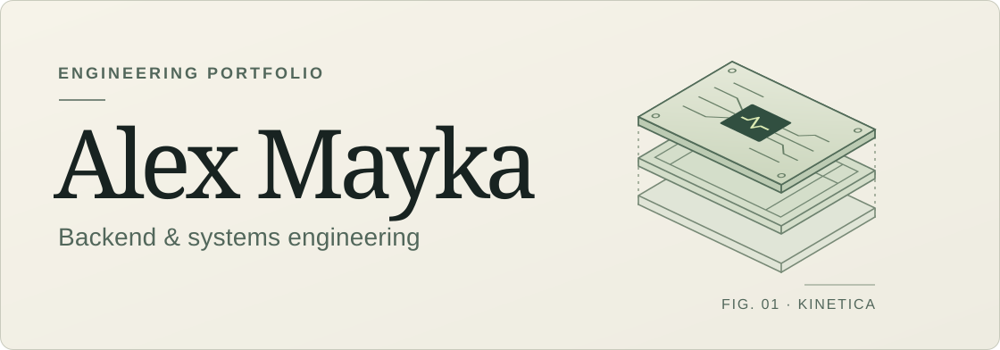
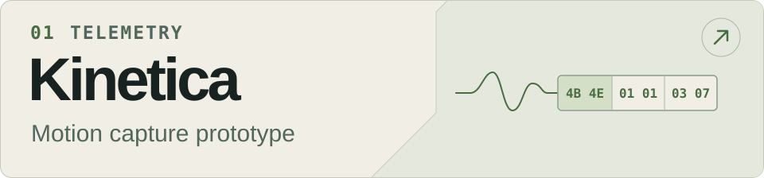
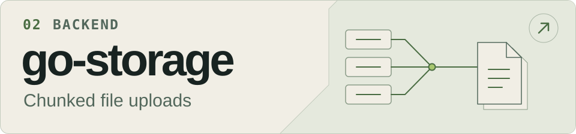
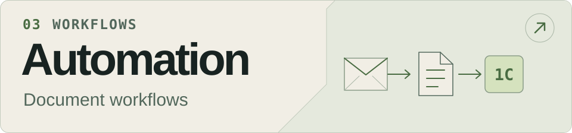

<h1></h1>

I build **Go and Python systems** for L7 traffic protection and business automation. I’ve led automation teams and taken services from architecture through deployment and monitoring.

  <a href="#selected-work"><strong>Work</strong></a>&nbsp;&nbsp;/&nbsp;&nbsp;
  <a href="#repository-index">Index</a>&nbsp;&nbsp;/&nbsp;&nbsp;
  <a href="#contact">Contact</a>

## Selected work

### Motion telemetry

An ESP32 and Go motion-capture prototype. The separate Go protocol library encodes binary frames, checks their integrity, and includes adapters for TCP, UDP, serial, and BLE.

[Kinetica Platform](https://github.com/AlexMayka/kinetica-platform) · [Protocol library](https://github.com/AlexMayka/kinetica-protocol) · [Frame tests](https://github.com/AlexMayka/kinetica-protocol/blob/main/protocol/codec/codec_test.go) · [Firmware](https://github.com/AlexMayka/kinetica-platform/blob/main/esp/imu-sensor/components/fms/fms.c)

### Go services

File metadata stays in PostgreSQL, scoped by organization. MinIO assembles the uploaded chunks. A separate wallet API uses PostgreSQL row locks to serialize updates to the same balance.

[go-storage](https://github.com/AlexMayka/go-storage) · [Upload assembly](https://github.com/AlexMayka/go-storage/blob/main/internal/repository/minio/repository.go#L87-L116) · [wallet-api](https://github.com/AlexMayka/wallet-api) · [Wallet lock](https://github.com/AlexMayka/wallet-api/blob/main/internal/repositories/wallet_repositories.go#L45-L49)

### Business automation

A collection of Go and Python services. The document workflow moves email attachments into 1C and tracks their processing status. Other workflows cover call transcription with Whisper and checklist scoring.

[Automation monorepo](https://github.com/AlexMayka/automation-monorepo) · [Document workflow](https://github.com/AlexMayka/automation-monorepo/tree/main/primary-documents) · [Call analysis](https://github.com/AlexMayka/automation-monorepo/tree/main/call_analysis)

## Repository index

- [gogram](https://github.com/AlexMayka/gogram) · Go SDK for Telegram bots with [stateful conversations](https://github.com/AlexMayka/gogram/blob/main/examples/register-flow/register-flow.go).
- [go-max-sdk](https://github.com/AlexMayka/go-max-sdk) · Go SDK for MAX bots with a [route compiler](https://github.com/AlexMayka/go-max-sdk/blob/dev/internal/registry/registry.go#L19-L38) that indexes handlers by event and conversation state.

Five more projects

- [adapt_ed](https://github.com/AlexMayka/adapt_ed) · Go API for schools, classes, and learner profiles.
- [merch-shop](https://github.com/AlexMayka/merch-shop) · Shop API with transactional purchases and virtual coin transfers.
- [geo-distance-calculator](https://github.com/AlexMayka/geo-distance-calculator) · Address geocoding and distance to sampled boundary points.
- [gosuslugi-it-checker](https://github.com/AlexMayka/gosuslugi-it-checker) · Batch IT accreditation lookup by company tax ID with CSV output.
- [pycli-file-manager](https://github.com/AlexMayka/pycli-file-manager) · Python terminal file manager with a command registry and unit tests.

## Contact

[Telegram](https://t.me/Alex_Mayka) · [Gmail](mailto:aleksey.mayka.w@gmail.com) · [Yandex Mail](mailto:alex.mayka20@yandex.ru)
