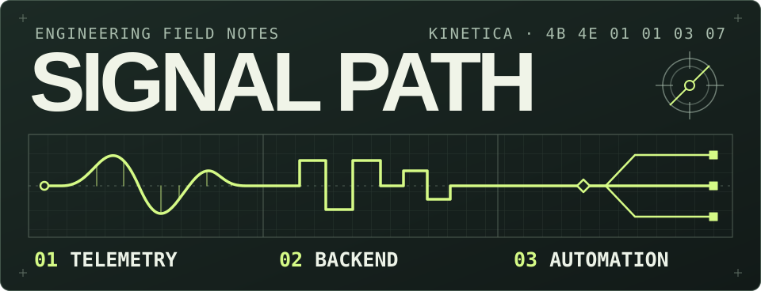

# Alex Mayka

**Backend & systems engineer · Go and Python**

I work on L7 traffic protection and build services that automate document processing and connect business systems. I’ve led automation teams and taken services from design through deployment and monitoring.

## Selected work

### 01 / Telemetry

[**Kinetica**](https://github.com/AlexMayka/kinetica-platform) is a motion-capture prototype with ESP32 firmware and a Go host. Its separate [protocol library](https://github.com/AlexMayka/kinetica-protocol) encodes and validates binary frames and includes TCP, UDP, serial, and BLE adapters. [Frame tests](https://github.com/AlexMayka/kinetica-protocol/blob/main/protocol/codec/codec_test.go) · [Firmware state machine](https://github.com/AlexMayka/kinetica-platform/blob/main/esp/imu-sensor/components/fms/fms.c)

### 02 / Backend

[**go-storage**](https://github.com/AlexMayka/go-storage) keeps file metadata by organization in PostgreSQL and assembles chunked uploads in MinIO. [**wallet-api**](https://github.com/AlexMayka/wallet-api) uses row locks to serialize concurrent balance updates to the same wallet. [Upload assembly](https://github.com/AlexMayka/go-storage/blob/main/internal/repository/minio/repository.go#L87-L116) · [Wallet lock](https://github.com/AlexMayka/wallet-api/blob/main/internal/repositories/wallet_repositories.go#L45-L49)

I also build Go SDKs for bots. [**gogram**](https://github.com/AlexMayka/gogram) supports stateful Telegram conversations. [**go-max-sdk**](https://github.com/AlexMayka/go-max-sdk) compiles routes into a handler table keyed by event type and conversation state. [Telegram conversation example](https://github.com/AlexMayka/gogram/blob/main/examples/register-flow/register-flow.go) · [MAX route compiler](https://github.com/AlexMayka/go-max-sdk/blob/dev/internal/registry/registry.go#L19-L38)

### 03 / Automation

[**automation-monorepo**](https://github.com/AlexMayka/automation-monorepo) collects Go and Python services for business workflows. One takes attachments from email to 1C and tracks their processing status. The call analysis projects cover Whisper transcription and checklist scoring. [Document workflow](https://github.com/AlexMayka/automation-monorepo/tree/main/primary-documents) · [Call analysis](https://github.com/AlexMayka/automation-monorepo/tree/main/call_analysis)

More repositories

- [adapt_ed](https://github.com/AlexMayka/adapt_ed) · Go API for schools, classes, and learner profiles.
- [merch-shop](https://github.com/AlexMayka/merch-shop) · Shop API with transactional purchases and virtual coin transfers.
- [geo-distance-calculator](https://github.com/AlexMayka/geo-distance-calculator) · Address geocoding and distance to sampled boundary points.
- [gosuslugi-it-checker](https://github.com/AlexMayka/gosuslugi-it-checker) · Batch IT accreditation lookup by company tax ID with CSV output.
- [pycli-file-manager](https://github.com/AlexMayka/pycli-file-manager) · Python terminal file manager with a command registry and unit tests.

---

[Telegram](https://t.me/Alex_Mayka) · [Gmail](mailto:aleksey.mayka.w@gmail.com) · [Yandex Mail](mailto:alex.mayka20@yandex.ru)
