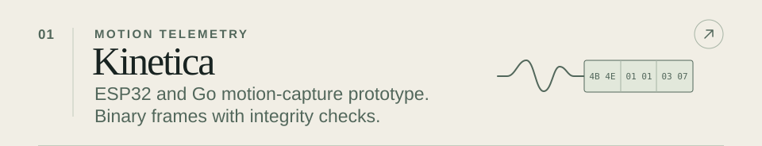
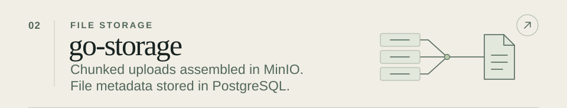
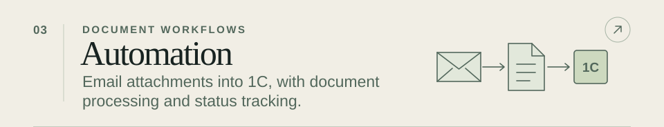

<picture><source media="(max-width: 600px)" srcset="assets/portfolio-cover-mobile.svg"></picture>

<a href="https://github.com/AlexMayka/kinetica-platform"><picture><source media="(max-width: 600px)" srcset="assets/portfolio-kinetica-mobile.svg"></picture></a>

<a href="https://github.com/AlexMayka/go-storage"><picture><source media="(max-width: 600px)" srcset="assets/portfolio-storage-mobile.svg"></picture></a>

<a href="https://github.com/AlexMayka/automation-monorepo"><picture><source media="(max-width: 600px)" srcset="assets/portfolio-automation-mobile.svg"></picture></a>

<a href="https://t.me/Alex_Mayka"><picture><source media="(max-width: 600px)" srcset="assets/portfolio-contact-mobile.svg"></picture></a>

Project notes, source links and contacts

### Alex Mayka

I build Go and Python systems for L7 traffic protection and business automation. I’ve led automation teams and taken services from architecture through deployment and monitoring.

### Selected work

- **Motion telemetry.** [Kinetica Platform](https://github.com/AlexMayka/kinetica-platform) is an ESP32 and Go motion-capture prototype. Its separate [protocol library](https://github.com/AlexMayka/kinetica-protocol) validates binary frames and has TCP, UDP, serial, and BLE adapters. [Frame tests](https://github.com/AlexMayka/kinetica-protocol/blob/main/protocol/codec/codec_test.go) · [Firmware](https://github.com/AlexMayka/kinetica-platform/blob/main/esp/imu-sensor/components/fms/fms.c)
- **Go services.** [go-storage](https://github.com/AlexMayka/go-storage) keeps file metadata by organization in PostgreSQL and assembles chunks in MinIO. [wallet-api](https://github.com/AlexMayka/wallet-api) uses row locks to serialize concurrent updates to the same balance. [Upload assembly](https://github.com/AlexMayka/go-storage/blob/main/internal/repository/minio/repository.go#L87-L116) · [Wallet lock](https://github.com/AlexMayka/wallet-api/blob/main/internal/repositories/wallet_repositories.go#L45-L49)
- **Business automation.** The [automation monorepo](https://github.com/AlexMayka/automation-monorepo) collects Go and Python services. The document workflow moves email attachments into 1C and tracks their status. Other workflows cover Whisper transcription and checklist scoring. [Document workflow](https://github.com/AlexMayka/automation-monorepo/tree/main/primary-documents) · [Call analysis](https://github.com/AlexMayka/automation-monorepo/tree/main/call_analysis)

### More repositories

- [gogram](https://github.com/AlexMayka/gogram) · Go SDK for Telegram bots with [stateful conversations](https://github.com/AlexMayka/gogram/blob/main/examples/register-flow/register-flow.go).
- [go-max-sdk](https://github.com/AlexMayka/go-max-sdk) · Go SDK for MAX bots with a [route compiler](https://github.com/AlexMayka/go-max-sdk/blob/dev/internal/registry/registry.go#L19-L38) indexed by event and conversation state.
- [adapt_ed](https://github.com/AlexMayka/adapt_ed) · Go API for schools, classes, and learner profiles.
- [merch-shop](https://github.com/AlexMayka/merch-shop) · Shop API with transactional purchases and virtual coin transfers.
- [geo-distance-calculator](https://github.com/AlexMayka/geo-distance-calculator) · Address geocoding and distance to sampled boundary points.
- [gosuslugi-it-checker](https://github.com/AlexMayka/gosuslugi-it-checker) · Batch IT accreditation lookup by company tax ID with CSV output.
- [pycli-file-manager](https://github.com/AlexMayka/pycli-file-manager) · Python terminal file manager with a command registry and unit tests.

### Contact

[Telegram](https://t.me/Alex_Mayka) · [Gmail](mailto:aleksey.mayka.w@gmail.com) · [Yandex Mail](mailto:alex.mayka20@yandex.ru)

